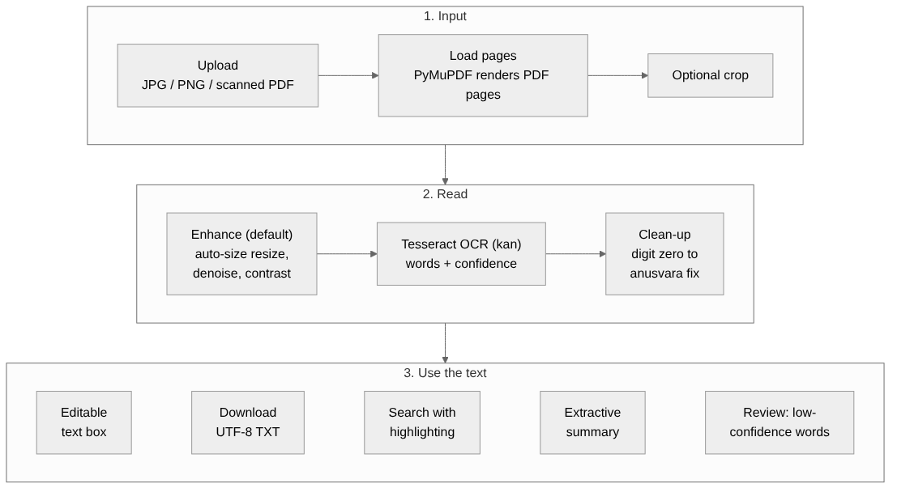

# KannadaLens AI: Smart Kannada Document Digitizer

Turn a printed Kannada document (a photo, screenshot or scanned PDF) into
**editable, searchable, downloadable text**, with a clear view of which words
the OCR is unsure about.

Everything runs **on your own computer**. Documents are never sent to an
external service, and every tool used is free and open source.

> **Scope:** printed Kannada only. Handwritten Kannada is **not supported**
> (we tried one handwritten page and the result was not usable).

## What it does

| Feature | How it works |
|---|---|
| Read Kannada text | Tesseract OCR with Kannada data (`kan`), from JPG, PNG or scanned PDF |
| Better reading of small or faint text | "Enhance" preset: auto-size enlargement, denoise, contrast |
| Crop | Cut away pictures, side columns or boxed headings before reading |
| Fix a common OCR mistake | Digit zero (೦) read inside a word is changed to the anusvara (ಂ) |
| Review | Words Tesseract is unsure about are highlighted in yellow (adjustable limit) |
| Edit | The result appears in a text box you can correct by hand |
| Search | Find a word or phrase, with highlighting (ignores invisible joiner characters) |
| Summary | Honest **extractive** preview and key sentences (copied, not generated) |
| Export | Download as UTF-8 TXT (opens correctly in Windows Notepad) |
| PDF | Scanned PDFs, up to 10 pages per run, with page markers in the text |

## Architecture




```
kannadalens/
  app.py                  the Streamlit app
  core/
    tesseract_setup.py    finds Tesseract and checks Kannada data is installed
    ocr.py                runs OCR, returns text and a confidence score per word
    preprocess.py         Enhance preset (auto-size resize, denoise, contrast)
    textsize.py           measures letter height so small text is enlarged, large text is left alone
    crop.py               percent-based crop and preview
    pdf.py                renders scanned PDF pages (PyMuPDF)
    textutils.py          anusvara clean-up, search, highlighting
    summary.py            extractive summary and statistics
    metrics.py            character and word error rate (used by the evaluation)
  day1_check.py           checks your Tesseract + Kannada installation
  day6_evaluate.py        measures accuracy on testset/ (see Evaluation)
  day6_confidence_check.py  measures how useful the confidence highlighting is
  testset/                images (docNN.png) with typed reference texts (docNN.txt)
  samples/  extras/  outputs/
```

## Setup (Windows 10/11)

Developed and tested on Windows with Python 3.14, VS Code and Tesseract 5.5.3.

1. **Install Tesseract** (the UB Mannheim Windows build) and, in the installer,
   tick **Kannada** under *Additional language data*.
2. **Create the environment and install packages**, in a terminal inside the project folder:

   ```powershell
   python -m venv .venv
   .venv\Scripts\Activate.ps1
   pip install -r requirements.txt
   ```

   `requirements.txt` contains: `pytesseract`, `Pillow`, `streamlit`,
   `opencv-python`, `numpy`, `pymupdf`.
3. **Check the installation** (it should report Kannada support and read a sample):

   ```powershell
   python day1_check.py
   ```
4. **Start the app**:

   ```powershell
   streamlit run app.py
   ```

   Open the address it prints (usually http://localhost:8501).

## How to use it

1. Upload a JPG, PNG or scanned PDF.
2. (Optional) Open **Crop** and cut away anything you do not want read.
3. Click **Extract Kannada text**.
4. Open the **Review** tab: yellow words are the ones to check first.
5. Correct the text in the box, **search** it, read the **summary**, and **download the TXT**.

## Evaluation

We measured accuracy on a **small test set of 7 printed Kannada images**
(`testset/`): screenshots of printed text, five used while tuning and two
(doc07, doc08) kept aside as hold-out images. Reference texts were prepared
by the team from the source text. Handwriting was **not** evaluated.

Error rates are Levenshtein edit distance divided by reference length
(characters, or words), ignoring whitespace. Lower is better. Overall rows are
pooled: total errors divided by total reference characters or words.

| Image | Size (px) | Off: char / word error | Final (Enhance + clean-up): char / word error |
|---|---|---|---|
| doc01 | 500 x 737 | 6.4% / 35.8% | 4.0% / 30.5% |
| doc02 | 410 x 371 | 6.4% / 35.5% | 3.7% / 22.0% |
| doc03 | 417 x 455 | 1.8% / 8.8% | 1.2% / 5.0% |
| doc04 | 542 x 707 | 1.7% / 4.3% | 1.2% / 4.3% |
| doc05 | 405 x 207 | 7.0% / 32.9% | 3.3% / 21.1% |
| doc07 (hold-out) | 1000 x 611 | 3.0% / 21.0% | 1.5% / 8.9% |
| doc08 (hold-out) | 610 x 430 | 7.4% / 37.9% | 3.5% / 18.4% |
| **Overall (7 images)** | | **5.1% / 27.6%** | **2.7% / 15.6%** |

On this set, Enhance + clean-up was never worse than Off + clean-up on any image.

**Read this honestly:** with the best setting, roughly **1 word in 6 is still
wrong**. The test set is small and mostly screenshots, so these numbers do not
describe accuracy on real scans or phone photos.

**Confidence highlighting** (975 words from the same 7 images, 15% of them wrong):
at the default limit of 80, 17% of words are highlighted; about half of the
highlighted words are wrong (48%, against 15% for a random word) and about
half of all wrong words are caught (53%). It is a good first-pass aid, not an
error detector: a word that is not highlighted can still be wrong.

Reproduce the numbers:

```powershell
python day6_evaluate.py
python day6_confidence_check.py
```

## Limitations

- **Printed text only.** Handwriting is not supported.
- **Accuracy:** about 1 word in 6 wrong on our test set; always review the text.
- **Layout:** pages with boxed headings, side columns, tables or letters may come
  out in the wrong reading order (use **Crop** to read one block at a time).
  Tables and forms are not understood.
- **Small, faint or low-resolution images** read worse. Rare loanwords written in
  Kannada letters are often garbled.
- **The summary is extractive.** It copies the sentences with the most repeated
  words. It does not understand, rewrite or translate, and it can include OCR errors.
- **Evaluation is small** (7 images) and the images are mostly screenshots.
- PDFs: up to 10 pages per run; password-protected or damaged PDFs are rejected with a message.

## Future work

- A larger, more varied test set (phone photos, real scans, different fonts)
- Straightening skewed photos and handling uneven lighting
- Automatic detection of blocks and reading order
- Spell-check suggestions for Kannada words
- A real Kannada summarizer, with its limits tested the same way as the OCR

## Credits and licences

- [Tesseract OCR](https://github.com/tesseract-ocr/tesseract) and its Kannada
  language data (Apache 2.0); Windows build by UB Mannheim
- Streamlit, pytesseract, OpenCV, NumPy (Apache 2.0 / BSD-style), Pillow (HPND)
- **PyMuPDF** is licensed **AGPL-3.0** (or commercially). Check this before
  distributing the app beyond the hackathon.
- Most sample images are screenshots of Kannada Wikipedia text, which is available
  under CC BY-SA. Credit: Kannada Wikipedia contributors. Check the source of any
  other image before publishing it.
